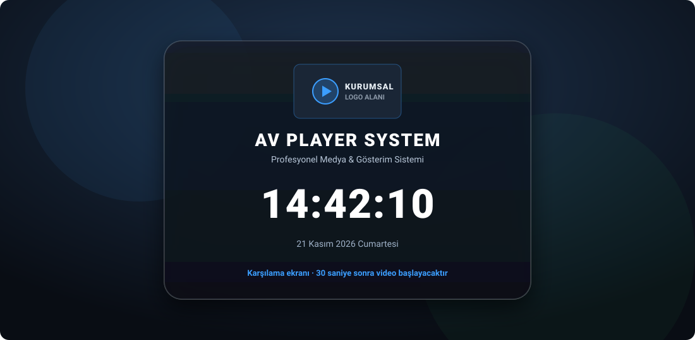
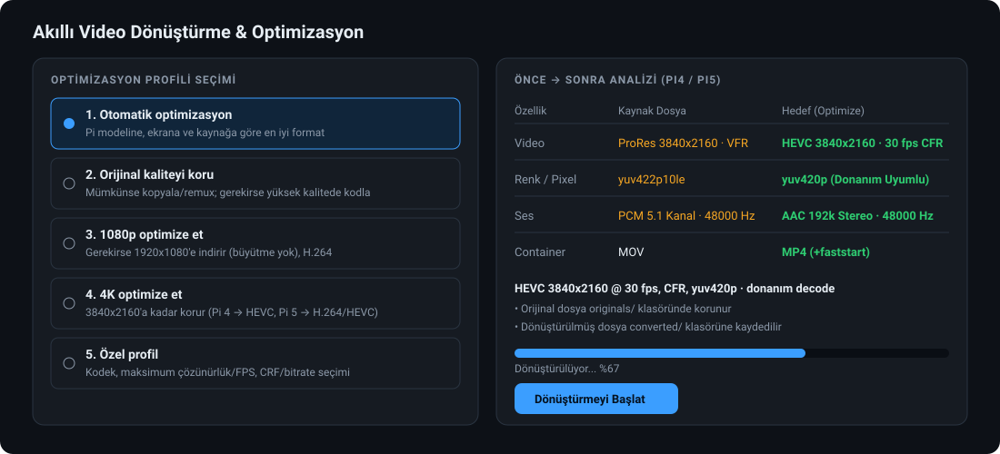
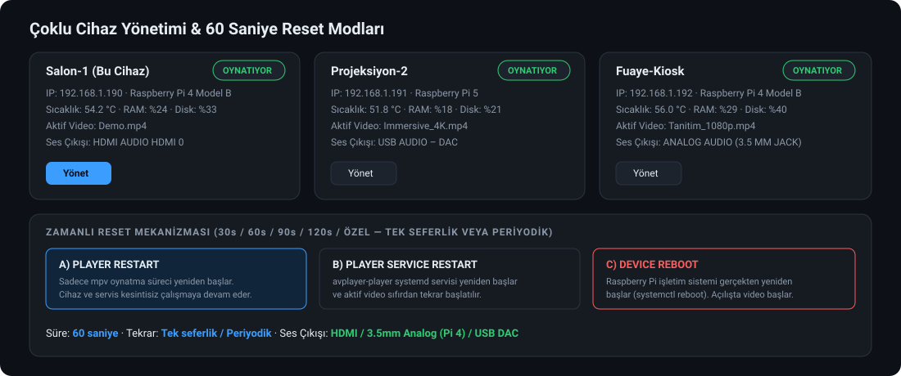

# AV Player – Raspberry Pi 4 / 5 Profesyonel Video Oynatma & Yönetim Sistemi

Müze, dijital sergi, projeksiyon, immersive alan ve profesyonel AV uygulamaları için geliştirilmiş; **Raspberry Pi 4 ve Raspberry Pi 5** üzerinde çalışan, kendi kendini onaran (self-healing), tam ekran, elektrik geldiğinde otomatik başlayan, **Kurumsal Karşılama Ekranı (Logo, Şirket İsmi, Arka Plan Görseli ve Canlı Saat)** ile **Akıllı FFmpeg Optimizasyonuna** sahip profesyonel video oynatma sistemi.

---

## Ekran Görüntüleri

### 1. Kurumsal Karşılama & Bekleme Ekranı (Web ve HDMI Birebir Aynı Buzlu Cam Tasarım)


### 2. Ana Kontrol Paneli (Canlı Durum, Oynatma İstatistikleri & Ses)


### 3. Akıllı Video Analiz & Dönüştürme Sistemi (1080p / 1920x1200 WUXGA / 4K Profilleri)


### 4. Çoklu Cihaz Yönetimi & 60 Saniye Zamanlı Reset Modları


---

## Temel Özellikler

1. **Kurumsal Karşılama & Bekleme Ekranı (Web + HDMI 1:1):**
   - Cihaz ilk açıldığında **30 saniye boyunca** (ayarlanabilir) veya video durdurulduğunda hem TV/Projeksiyon ekranında hem de Web panelinde tam ekran gösterilir.
   - Panelden **Tam Ekran Arka Plan Görseli (Background)**, **Kurumsal Logo**, **Şirket / Kurum İsmi** ve **Alt Başlık** yüklenebilir.
   - Ortadaki oval köşeli buzlu cam (Frosted Glass) kart üzerinde **Canlı Dijital Saat (`14:42:10`)** ve **Türkçe Tarih (`21 Kasım 2026 Cumartesi`)** her saniye canlı sayar.
   - Video başladığı anda karşılama ekranı tamamen kapatılır ve RAM'den silinir (**%0 arka plan yükü**).
2. **Elektrik Kesintisine Dayanıklı Otomatik Açılış & 60 Saniye Reset:**
   - Elektrik kesilip geldiğinde (fiş çekilip takıldığında) `fsck.mode=auto fsck.repair=yes`, `hdmi_force_hotplug=1` ve DRM hazırlık kontrolü ile ilk seferde takılmadan açılır.
   - **60 Saniye Sonra Yeniden Başlatma (`Her açılışta 1 kez` veya `Periyodik`):**
     - **A) PLAYER RESTART:** Sadece MPV oynatma sürecini yeniden başlatır.
     - **B) PLAYER SERVICE RESTART:** `avplayer-player.service` systemd servisini yeniden başlatır.
     - **C) DEVICE REBOOT:** Raspberry Pi işletim sistemini gerçekten yeniden başlatır (`systemctl reboot`) ve döndüğünde 30 sn beklemeden doğrudan videoya girer.
   - Yeniden başlatma öncesinde HDMI ekranda tek satır halinde **panelden özelleştirilebilir Türkçe geri sayım uyarısı** (`60 saniye sonra sistem yeniden başlatılacaktır`) gösterilir.
3. **Sıfır-Kopya (Zero-Copy) Donanım Decode & Akıllı FFmpeg Dönüştürme:**
   - Raspberry Pi 4 ve Pi 5'in gerçek donanım çözücülerini (`drm` HEVC ve `v4l2m2m` H.264) otomatik seçer.
   - **6 Dönüştürme Profili:** 1) Otomatik, 2) Orijinal kalite, 3) 1080p (1920x1080), 4) **WUXGA (1920x1200 - 16:10 projeksiyon)**, 5) **4K (3840x2160 HEVC)**, 6) Özel profil.
   - Orijinal dosyayı `originals/` klasöründe korur, optimize dosyayı `converted/` klasöründe saklar.
4. **Ses Çıkışı & Çoklu Cihaz Yönetimi:**
   - **HDMI AUDIO**, **ANALOG AUDIO (3.5mm - Pi 4)** ve **USB AUDIO** çıkışlarını otomatik tespit eder.
   - Tek panelden birden fazla Raspberry Pi cihazını izleme, yönetme ve toplu video gönderme.
   - Tek tıkla **Tüm Logları Temizle** ve **Dönüştürme Geçmişini Temizle**.

---

## Adım Adım Kurulum ve Kullanım Rehberi

### Adım 1: Raspberry Pi İşletim Sisteminin Hazırlanması
1. **Raspberry Pi Imager** ile SD karta **Raspberry Pi OS (64-bit)** yazdırın.
2. Yazdırmadan önce **Ayarlar (Dişli İkonu)** içinden:
   - **Kullanıcı adı:** `pi` ve şifrenizi belirleyin.
   - **SSH:** `"Enable SSH (Use password authentication)"` kutucuğunu işaretleyin.
   - **Wi-Fi / Ethernet:** Ağ bilgilerinizi girin.
3. SD kartı Raspberry Pi'ye takıp elektriğe bağlayın.

---

### Adım 2: Windows Bilgisayardan Raspberry Pi'ye Tek Komutla Kurulum (ve Sabit IP Verme)
Windows bilgisayarınızda **PowerShell**'i açın ve proje klasörüne giderek şu komutu çalıştırın (`192.168.1.190` yerine kendi Pi IP adresinizi yazın):

```powershell
cd "C:\Users\kadir\Desktop\Raspi conf\avplayer"
powershell -ExecutionPolicy Bypass -File .\deploy.ps1 -PiIP 192.168.1.190 -StaticIP
```

> **Bu komut otomatik olarak şunları yapar:**
> 1. Tüm proje dosyalarını tek pakette Raspberry Pi'ye kopyalar.
> 2. Gerekli paketleri (`ffmpeg`, `mpv`, `python3-pil`, `alsa-utils`, `FastAPI`, `Uvicorn`, `Pillow`) kurar.
> 3. Raspberry Pi'nin IP adresini (`192.168.1.190`) sabitler (`-StaticIP`).
> 4. Masaüstünü ve arka plandaki tüm gereksiz servisleri (`wayvnc`, `museum-agent`, `bluetooth`, `cups`, `ModemManager`) kapatıp konsol (DRM/KMS) moduna alır.
> 5. `avplayer-web.service` ve `avplayer-player.service` servislerini etkinleştirip başlatır.

Kurulumdan sonra kodda yapılan güncellemeleri 5 saniyede göndermek için:
```powershell
powershell -ExecutionPolicy Bypass -File .\deploy.ps1 -PiIP 192.168.1.190 -Update
```

---

### Adım 2B: Aynı Sistemi Doğrudan Windows PC / Mini PC / NUC Üzerine Kurma
İsterseniz Raspberry Pi yerine (veya Raspberry Pi cihazlarınızla birlikte aynı ağda) herhangi bir **Windows 10 / 11 Mini PC / Media Server** bilgisayara da birebir aynı sistemi tek komutla kurabilirsiniz.

**Yönetici (Administrator) PowerShell** açıp şu komutu çalıştırın:
```powershell
cd "C:\Users\kadir\Desktop\Raspi conf\avplayer"
powershell -ExecutionPolicy Bypass -File .\install-windows.ps1
```
*(İsteğe bağlı olarak sabit IP ve port da verebilirsiniz: `.\install-windows.ps1 -Port 80 -StaticIP 192.168.1.220`)*

> **Windows Kurulumu Otomatik Olarak Şunları Yapar:**
> 1. Python, FFmpeg ve MPV'yi kontrol eder (eksikse `winget` / `static-ffmpeg` ile otomatik kurar).
> 2. Verileri `C:\ProgramData\AVPlayer` altında yapılandırır, Windows Named Pipe (`\\.\pipe\avplayer-mpv`) ve Direct3D 11 (`--gpu-context=d3d11 --hwdec=d3d11va,nvdec,dxva2`) donanım hızlandırmasını devreye alır.
> 3. NVIDIA (`h264_nvenc`), Intel QuickSync (`h264_qsv`) veya AMD (`h264_amf`) GPU donanım encoder'larını otomatik test edip video dönüştürmede kullanır.
> 4. Windows WASAPI ses çıkışlarını (HDMI, Hoparlör/3.5mm, USB DAC) otomatik algılar.
> 5. 60 saniye reset modlarında **Player Restart**, **Service Restart** ve **Device Reboot (`shutdown /r /t 0 /f`)** birebir aynı şekilde çalışır.
> 6. Uyku modunu/ekran kapatmayı devre dışı bırakır, güvenlik duvarı portunu açar ve Windows açılışında (`ONLOGON`) otomatik başlayan `AVPlayer-Web` ve `AVPlayer-Player` görevlerini oluşturur.
> 7. **Durdurmak / Kapatmak için:**
>    ```powershell
>    powershell -ExecutionPolicy Bypass -File .\stop-windows.ps1          # Oynatıcıyı ve arka planı durdurur
>    powershell -ExecutionPolicy Bypass -File .\stop-windows.ps1 -Disable # Otomatik açılmayı geçici olarak kapatır
>    powershell -ExecutionPolicy Bypass -File .\stop-windows.ps1 -Enable  # Otomatik açılmayı tekrar aktif eder
>    powershell -ExecutionPolicy Bypass -File .\stop-windows.ps1 -Start   # Servisleri tekrar başlatır
>    ```
> 8. **Tamamen Kaldırmak için:**
>    ```powershell
>    powershell -ExecutionPolicy Bypass -File .\install-windows.ps1 -Uninstall
>    ```

---

### Adım 3: Web Yönetim Paneline Giriş
Aynı ağdaki herhangi bir bilgisayar, tablet veya telefondan tarayıcıyı açıp Raspberry Pi'nin IP adresine girin:
```text
http://192.168.1.190
```

---

### Adım 4: Karşılama Ekranı (Logo, Arka Plan Görseli ve Şirket İsmi) Ayarlama
1. Üst menüden **Ayarlar** sayfasına girin.
2. **Karşılama & Bekleme Ekranı (Şirket İsmi, Logo ve Saat)** kartında:
   - **İlk açılışta Karşılama Ekranı bekleme süresi:** `30` sn (cihaz açıldığında 30 sn bu ekran kalır, sonra video başlar).
   - **Şirket / Kurum İsmi** ve **Alt Başlık** kutularını doldurup **Karşılama Ayarlarını Kaydet**'e basın.
   - **Logo Yükle** butonuyla kurum logonuzu (PNG/JPG/SVG) yükleyin.
   - **Arka Plan Görseli Yükle** butonuyla tam ekran duvar kağıdınızı (1920x1080 JPG/PNG) yükleyin.
3. Üst menüdeki **Karşılama Ekranı** sekmesinden görünümü tam ekran olarak inceleyebilirsiniz.

---

### Adım 5: Video Yükleme, Optimize Etme ve Aktif Yapma
1. Üst menüden **Videolar** sayfasına girin.
2. Videolarınızı sürükleyip bırakın veya **dosya seçin** ile yükleyin.
   - Video zaten Pi donanımına uygunsa durumu doğrudan **`HAZIR`** olur.
   - 1920x1200 (WUXGA), 4K veya telefon/kurgu videoları için **Dönüştür** butonuna tıklayıp ekranınıza uygun profili seçin:
     - **1080p Ekranlar:** `3. 1080p (1920x1080) optimize et`
     - **1920x1200 Projeksiyonlar:** `4. WUXGA (1920x1200) optimize et`
     - **4K Ekranlar:** `5. 4K (3840x2160) optimize et`
3. **Aktif yap** butonuna tıklayın. Cihaz bundan sonra her elektrik geldiğinde bu videoyu otomatik oynatacaktır.

---

### Adım 6: 60 Saniye Sonra Otomatik Yeniden Başlatma ve Ekran Uyarısı Ayarlama
1. **Ayarlar → Zamanlı Reset** kartına gidin:
   - **"Video başladıktan sonra otomatik reset etkin"** kutusunu işaretleyin.
   - **"HDMI ekranda yeniden başlatma geri sayım uyarısını göster"** kutusunu işaretleyin.
   - **Ekranda görünecek uyarı metni:** İstediğiniz Türkçe metni yazın (ör. `{saniye} saniye sonra sistem yeniden başlatılacaktır`).
   - **Mod Seçimi:**
     - **A) PLAYER RESTART** (Sadece mpv sürecini yeniler)
     - **B) PLAYER SERVICE RESTART** (Oynatma servisini yeniler)
     - **C) DEVICE REBOOT** (Raspberry Pi'yi gerçekten reboot eder)
   - **Süre:** `60 saniye` · **Tekrar:** `Her açılışta 1 kez` (fiş her çekilip takıldığında 60 sn sonra 1 kez çalışır ve ardından kesintisiz oynatır).
2. **Kaydet** butonuna basın.

---

### Adım 7: Ses Çıkışı ve Çoklu Cihaz Yönetimi
- **Ses Çıkışı:** **Panel** veya **Ayarlar** sayfasından cihazda tespit edilen **HDMI AUDIO**, **ANALOG AUDIO (3.5mm - Pi 4)** veya **USB AUDIO** çıkışını seçip ses seviyesini ayarlayın.
- **Çoklu Cihaz:** Birden fazla Raspberry Pi varsa, diğer Pi'lerin IP adresini ve API anahtarını (Ayarlar → Güvenlik kartında yazar) **Cihazlar** sayfasından ekleyerek hepsini tek ekrandan yönetebilirsiniz.

---

## Dosya Yapısı

| Modül | Dosya | Açıklama |
|---|---|---|
| Web Sunucusu & Giriş | `app/main.py`, `app/config.py`, `app/db.py` | FastAPI uygulaması, fsync korumalı SQLite veritabanı |
| Çekirdek & Branding API | `app/api/core.py` | Durum, ayarlar, logo/arka plan yükleme, log temizleme |
| Video Kütüphanesi API | `app/api/videos.py`, `app/media.py` | Akışlı video yükleme, ffprobe analizi, geçmiş temizleme |
| Pi 4 / Pi 5 Planlayıcı | `app/profiles.py` | 1080p, 1920x1200 (WUXGA), 4K HEVC optimizasyon karar motoru |
| FFmpeg Dönüştürücü | `app/converter.py` | İlerleme yüzdeli, HW→SW yedekli arka plan dönüştürücü |
| Donanım & Self-Test | `app/hardware.py`, `app/selftest.py` | Gerçek FFmpeg encoder/decoder ve DRM ekran testi |
| MPV & Karşılama Gözetmeni | `app/player_daemon.py`, `app/mpv_ipc.py` | Pillow oval cam karşılama ekranı, 60sn reset, watchdog |
| Ses Çıkışı Yönetimi | `app/audio.py` | ALSA HDMI / 3.5mm Analog / USB DAC otomatik tespiti |
| Çoklu Cihaz Proxy | `app/api/devices.py` | Uzak Raspberry Pi cihazlarını tek panelden yönetim |
| Türkçe Web Arayüzü | `app/static/index.html`, `app/static/app.js`, `app/static/style.css` | Koyu temalı kontrol paneli ve tam ekran karşılama sekmesi |
| Kurulum & Servisler | `deploy.ps1`, `install.sh`, `scripts/set-static-ip.sh`, `systemd/` | Windows'tan tek komutla kurulum, sabit IP, systemd servisleri |
