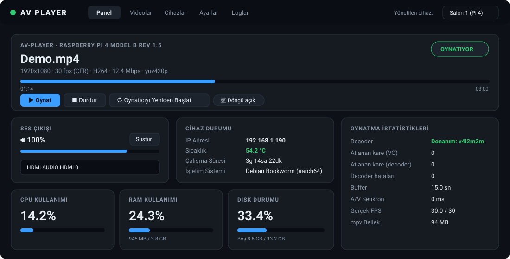

# AV Player – Raspberry Pi 4 / 5 Profesyonel Video Oynatma & Yönetim Sistemi

Müze, dijital sergi, projeksiyon, immersive alan ve profesyonel AV uygulamaları için geliştirilmiş; **Raspberry Pi 4 ve Raspberry Pi 5** üzerinde çalışan, kendi kendini onaran (self-healing), tam ekran, otomatik başlayan ve akıllı FFmpeg optimizasyonuna sahip profesyonel video oynatma sistemi.

---

## Ekran Görüntüleri

### 1. Ana Kontrol Paneli (Canlı Durum, Oynatma İstatistikleri & Ses)


### 2. Akıllı Video Analiz & Dönüştürme Sistemi (Pi 4 / Pi 5 Profilleri)


### 3. Çoklu Cihaz Yönetimi & 60 Saniye Zamanlı Reset Modları


---

## Özellikler

- **Türkçe Web Yönetim Paneli:** Aynı ağdaki herhangi bir bilgisayar, tablet veya telefondan `http://<pi-ip>` ile erişim.
- **Akıllı Video Dönüştürme (FFmpeg):**
  - Kaynak videonun codec, çözünürlük, FPS (CFR/VFR), bitrate, pixel formatı (`yuv420p`) ve ses kanallarını analiz eder.
  - Video zaten cihaza uygunsa **hiç yeniden kodlamaz** (kopya/remux).
  - **5 Seçenek:** 1) Otomatik optimizasyon, 2) Orijinal kaliteyi koru, 3) 1080p optimize et, 4) 4K optimize et, 5) Özel profil.
  - Orijinal dosyayı `originals/` klasöründe korur, optimize dosyayı `converted/` klasöründe saklar.
- **Kesintisiz Tam Ekran Oynatma (MPV + DRM/KMS):**
  - Masaüstü ve fare imleci görünmeden doğrudan DRM üzerinden tam ekran oynatma.
  - Açılışta sıfırdan başlar (`--start=0`), ses aktif tutulur, döngü (LOOP) destekler.
  - Canlı dropped frames, decoder hataları, A/V senkron ve buffer takibi.
- **60 Saniye Sonra Seçilebilir Yeniden Başlatma:**
  - **A) PLAYER RESTART:** Sadece MPV oynatma sürecini yeniden başlatır.
  - **B) PLAYER SERVICE RESTART:** `avplayer-player.service` systemd servisini yeniden başlatır.
  - **C) DEVICE REBOOT:** Raspberry Pi işletim sistemini gerçekten yeniden başlatır (`systemctl reboot`).
  - 30 / 60 / 90 / 120 saniye veya özel süre; tek seferlik veya periyodik seçenekli.
- **Ses Çıkışı Yönetimi:**
  - Cihazdaki gerçek ses çıkışlarını (`aplay -l`) otomatik tespit eder: **HDMI AUDIO**, **ANALOG AUDIO (3.5mm - sadece Pi 4)**, **USB AUDIO**.
  - Pi 5 üzerinde yerleşik 3.5mm jak olmadığı için otomatik gizlenir.
- **Çoklu Cihaz Yönetimi:** Tek panelden birden fazla Raspberry Pi cihazını izleme, yönetme ve aynı anda birden fazla cihaza video yükleme.

---

## Kurulum

### Windows'tan Tek Komutla Kurulum (PowerShell)
Raspberry Pi ile aynı ağdayken Windows PowerShell üzerinden tek komutla tüm sistemi kurabilir ve IP adresini sabitleyebilirsiniz:

```powershell
cd "C:\Users\kadir\Desktop\Raspi conf\avplayer"
powershell -ExecutionPolicy Bypass -File .\deploy.ps1 -PiIP 192.168.1.190 -StaticIP
```

Kod güncellemelerini göndermek için:
```powershell
powershell -ExecutionPolicy Bypass -File .\deploy.ps1 -PiIP 192.168.1.190 -Update
```

### Doğrudan Raspberry Pi Üzerinde Kurulum
```bash
sudo ./install.sh --static-ip 192.168.1.190
sudo reboot
```

---

## Dosya Yapısı

| Modül | Dosya |
|---|---|
| Web Sunucusu & Giriş Noktası | `app/main.py`, `app/config.py`, `app/db.py` |
| Yükleme & Video Kütüphanesi API | `app/api/videos.py`, `app/media.py` |
| Pi 4 / Pi 5 Optimizasyon Planlayıcı | `app/profiles.py` |
| FFmpeg Dönüştürme Motoru | `app/converter.py` |
| Gerçek Donanım & Encoder Testi | `app/hardware.py`, `app/selftest.py` |
| MPV Oynatma Gözetmeni & 60sn Reset | `app/player_daemon.py`, `app/mpv_ipc.py` |
| Ses Çıkışı Tespiti (HDMI / 3.5mm / USB) | `app/audio.py` |
| Çoklu Cihaz Proxy & Yönetim | `app/api/devices.py` |
| Türkçe Koyu Temalı Web Arayüzü | `app/static/index.html`, `app/static/app.js`, `app/static/style.css` |
| Systemd Servisleri & Kurulum | `systemd/`, `install.sh`, `deploy.ps1`, `scripts/set-static-ip.sh` |

---

## Testler
```bash
python -m pytest tests
```
Cihaz üzerinde donanım doğrulama testi:
```bash
sudo /opt/avplayer/venv/bin/python -m app.selftest
```
